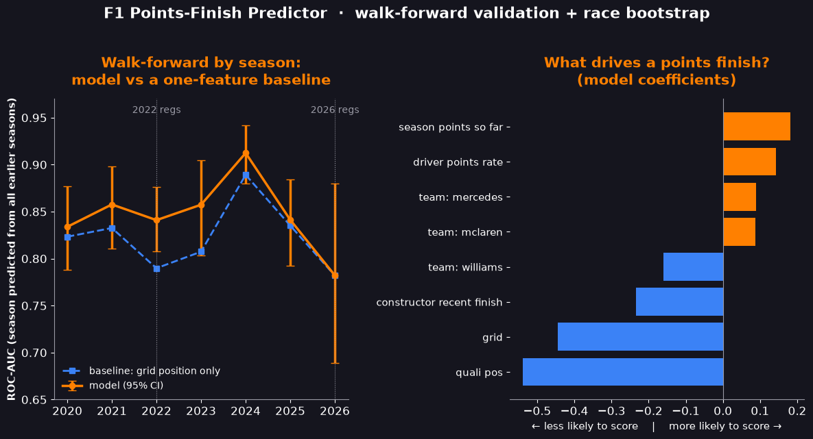
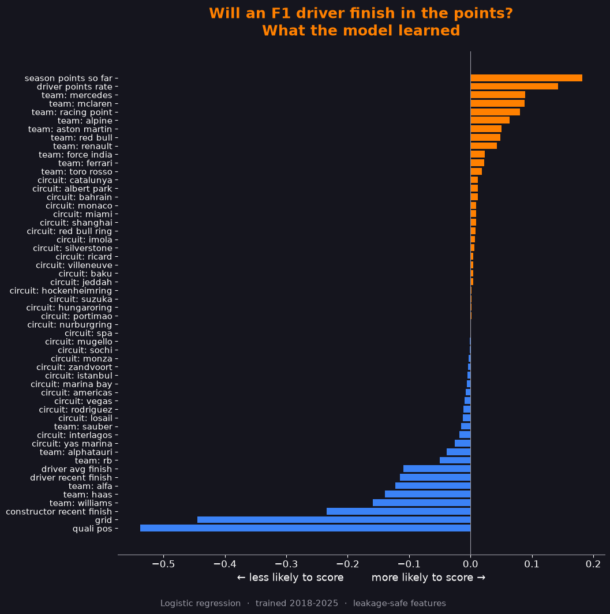

# 🏎️ F1 Points-Finish Predictor


Predicting whether a Formula 1 driver will **finish in the points (top 10)**
in a given race. It's a binary classification project focused on
**leakage-safe, time-aware machine learning, judged against an honest
baseline and with real uncertainty estimates**.

> Tested walk-forward season by season (2020–2025) and on 18 races of the
> 2026 season, the first under new power-unit and chassis regulations.

[**▶ Live demo**](https://f1-points-predictor-iq5km2fmjbqvkjbkxrn3pe.streamlit.app) · [**Results**](#results) · [**Audit log**](#audit-what-i-found-when-i-tried-to-break-my-own-pipeline)

---

## Why this project

F1 results are sequential: you predict the *next* race using only *past*
races. This project is built around that constraint, and **every claim is
backed by a test or a confidence interval**:

- **No data leakage, proven by tests.** `pytest` scrambles a race's
  results, or deletes all later races, and checks that no feature of
  that race changes.
- **Walk-forward validation by season.** Train on all earlier seasons and
  predict the next one. Races are never split across folds.
- **A baseline to beat.** Every score is compared with the simplest
  possible model: *rank drivers by starting grid position*.
- **Honest uncertainty.** 95% confidence intervals come from a **race-level
  block bootstrap**, because drivers in the same race are not independent.
- **Data validation.** Duplicate rows, gaps in finishing positions,
  impossible field sizes and odd encodings are caught before any feature
  is built.

---

## The data

Real data comes from the [Jolpica API](https://github.com/jolpica/jolpica-f1)
(the free successor to the deprecated Ergast API), covering 2018 to round 18
of 2026 (data as of 30 Oct 2026): **191 races, 3,854 driver-race rows**.
Each row is **one driver in one race**. `python src/fetch_data.py --update`
fetches only new races and is rate-limit safe and resumable.

`src/validate.py` checks it before use:
- one row per driver per race
- finishing positions exactly 1..N in every race
- field size between 15 and 24
- at most 2 cars per team
- no negative grid or points values

Known quirks (45 pit-lane starts, 9 missing qualifying positions) are
reported and handled explicitly.

A synthetic generator (`src/make_synthetic.py`) mirrors the schema for offline
development.

---

## Features (all leakage-safe, all tested)

| Feature | Description | Why it's safe |
|---|---|---|
| `grid` | Starting grid position; **pit-lane starts (`grid = 0`) mapped to the back** | Set before the race |
| `quali_pos` | Qualifying position | Known before the race |
| `driver_avg_finish` | Career-to-date average finish | Cumulative sum minus the current race |
| `driver_recent_finish` | Average finish, last 3 races | Shifted one race, then rolled |
| `driver_points_rate` | Share of past races in the points | Cumulative, current race excluded |
| `constructor_recent_finish` | Team's average finish over its last 3 races | **Aggregated per race first, then shifted by one *race*** |
| `season_points_so_far` | Championship points before this race | Cumulative within season, current race excluded |
| `constructorId`, `circuitId` | Team and circuit | Categorical, known in advance |

---

## Pipeline

```
validate_raw()  →  build_features()  →  Pipeline
                                          ├── numeric:     SimpleImputer → StandardScaler
                                          ├── categorical: SimpleImputer → OneHotEncoder
                                          └── LogisticRegression (C=0.01, class_weight="balanced")
```

All preprocessing lives inside one scikit-learn `Pipeline`, so it is re-fit
on each fold's training data only.

---

## Results



### 1. Walk-forward by season, against a one-feature baseline

Each season is predicted by a model trained on **all earlier seasons only**.
*Lift* = model AUC − grid-only AUC. The 95% CIs come from resampling whole
races (2,000 draws), and the lift CI is paired (same races for both).

| Season | Races | Model AUC [95% CI] | Grid-only AUC | Lift [95% CI] | Precision@10 model / grid |
|---|---|---|---|---|---|
| 2020 | 17 | 0.834 [0.788, 0.877] | 0.823 | +0.011 [−0.002, +0.022] | 0.759 / 0.747 |
| 2021 | 22 | 0.858 [0.811, 0.898] | 0.833 | +0.025 [+0.003, +0.045] | 0.786 / 0.782 |
| **2022** *(reg reset)* | 22 | 0.841 [0.808, 0.876] | 0.790 | **+0.051 [+0.030, +0.074]** | 0.786 / 0.727 |
| 2023 | 22 | 0.857 [0.804, 0.905] | 0.807 | +0.050 [+0.028, +0.074] | 0.795 / 0.736 |
| 2024 | 24 | 0.912 [0.880, 0.942] | 0.889 | +0.023 [+0.001, +0.046] | 0.846 / 0.838 |
| 2025 | 24 | 0.841 [0.792, 0.884] | 0.835 | +0.006 [−0.008, +0.020] | 0.767 / 0.779 |
| **2026** *(reg reset)* | 18 | 0.860 [0.810, 0.906] | 0.836 | **+0.024 [+0.005, +0.046]** | 0.761 / 0.756 |

**Reading it honestly:**
- **Grid position does most of the work.** It alone reaches AUC 0.79–0.89.
- **The extra form features add a real but small edge:** about +0.01 to
  +0.05 AUC, statistically significant in 5 of 7 seasons (the CI excludes 0).
- **The edge was largest in 2022–2023**, when grid position alone was least
  predictive. One hypothesis, not yet tested: after a rules change, recent
  team and driver form carries information that qualifying doesn't.
- **Precision@10** asks: *of the model's top 10 picks per race, how many
  scored?* Exactly 10 drivers score each race, so this is the natural
  question.

### 2. Did the 2026 regulation reset break the model? No.

The first version of this project reported an 8-point AUC drop in 2026 and
called it concept drift. That was based on the first **6 races**:

| 2026 data | Model AUC [95% CI] | Grid-only AUC | Lift [95% CI] |
|---|---|---|---|
| First 6 races | 0.782 [0.689, 0.880] | 0.782 | +0.000 [−0.027, +0.034] |
| **18 races** | **0.860 [0.810, 0.906]** | 0.836 | **+0.024 [+0.005, +0.046]** |
| 2020–2025 average | 0.857 | 0.830 | +0.028 |

- **The confidence interval was right.** After 6 races, the 95% CI was
  ~0.19 wide and contained the historical average, so the honest answer was
  "not enough evidence yet". With 18 races, 2026 performance and lift are
  indistinguishable from earlier seasons.
- **The early "drop" was noise.** The first races were harder to predict
  for everyone: the grid-only baseline also dipped (0.782), then recovered
  (0.836).
- **2022 agrees.** The previous major regulation reset also showed no
  degradation; it had the model's largest lift (+0.051).

**Lesson:** a point estimate from a small sample is not a finding. The drift
check is automated in `evaluate.py` and re-runs whenever new races arrive.

### 3. Model comparison

All three model families were tuned with the same season folds (28
configurations × 6 folds):

| Model | Walk-forward CV ROC-AUC (± std across seasons) |
|---|---|
| **Logistic Regression** | **0.857 ± 0.026** |
| Random Forest | 0.854 ± 0.025 |
| Gradient Boosting | 0.851 ± 0.025 |

The differences (≤ 0.006) are about 4× smaller than the season-to-season
variation (± 0.025), so they're **not meaningful**. The simplest, most interpretable model was
chosen.

### 4. Calibration and what drives a points finish

On 2026 (18 races), the model predicts a 46.0% average points probability
against an actual rate of 45.5% (Brier score 0.153), so its **probabilities
are well calibrated**. At the default 0.5 threshold, precision is 0.787 and
recall 0.717. Lowering the threshold to 0.4 trades to 0.750 / 0.800.

Qualifying and grid position dominate the coefficients, followed by
recent team form. Because `quali_pos` and `grid` are highly correlated,
their coefficients share the effect (multicollinearity).



---

## Audit: what I found when I tried to break my own pipeline

| # | Problem | How it was found | Fix | Effect |
|---|---|---|---|---|
| 1 | **Teammate leak.** Team form was shifted by *row*, but each team has 2 rows per race, so driver #2's feature contained driver #1's result from the **same race**. | Perturbation test: scrambling one race changed 10 of that race's own feature values. | Aggregate to one row per (team, race), shift by one *race*, merge back. | Small in AUC terms, but the "leak-free" claim is now true and tested. |
| 2 | **Pit-lane starts read as pole.** `grid = 0` (45 rows) looked *better* than P1. | Data validation report. | Map to the back of the grid (field size + 1). | Correct semantics. |
| 3 | **Folds split races in half.** `TimeSeriesSplit` cuts by row count, and all 5 fold boundaries fell mid-race. | Checked each fold boundary. | Walk-forward folds by whole season. | Clean, realistic validation. |
| 4 | **No baseline.** A model at AUC 0.85 sounds strong until grid position alone scores 0.83. | Added a grid-only baseline. | Every result reported as lift with a CI. | Honest headline. |
| 5 | **Drift claim without uncertainty.** An 8-point drop on 6 races was presented as a finding. | Race bootstrap CI, and 2022 as a control. | Claim withdrawn, check automated. | Confirmed with 18 races: no drift (Results §2). |

Also changed:
- **Feature engineering:** vectorised (`cumsum`/`cumcount` instead of
  `groupby().apply(lambda)`); outputs verified identical, **141 ms → 37 ms**.
- **Bootstrap:** uses a rank-based AUC (verified equal to sklearn's); the
  full evaluation runs in **~2 min → ~24 s**.

---

## Limitations and next steps

- **Small edge over the grid.** The next gains must come from information
  qualifying doesn't capture: team reliability (DNF rate), circuit
  overtaking difficulty, typical places gained from grid to finish, and
  qualifying gap to teammate. Each will be judged by its lift CI, and every
  attempt logged to keep the trial count honest.
- **Independent predictions.** The model scores each driver separately,
  while exactly 10 points places exist per race. A ranking model (e.g.
  LightGBM `lambdarank`) would use that constraint directly.
- **App features are pre-race.** The demo uses each driver's form *before*
  their latest race, so it lags by one race.

---

## Run it yourself

```bash
python -m venv .venv && source .venv/bin/activate
pip install -r requirements-dev.txt

make validate   # data-quality checks on data/f1_raw.csv
make test       # leakage + data tests (pytest)
make train      # walk-forward CV
make tune       # model comparison (GridSearchCV, season folds)
make evaluate   # walk-forward table, drift check, 2026 details, saves model
make charts     # regenerate the README figures

# fetch new races from the Jolpica API (incremental, resumable)
python src/fetch_data.py --update

streamlit run app.py
```

Tests run automatically on every push (GitHub Actions).

---

## Project structure

```
f1-points-predictor/
├── .github/workflows/tests.yml   # CI: validate data + run tests
├── assets/                       # result charts
├── data/f1_raw.csv
├── src/
│   ├── fetch_data.py      # Jolpica API fetcher (incremental, rate-limit safe)
│   ├── make_synthetic.py  # synthetic data (same schema)
│   ├── validate.py        # data-quality checks
│   ├── features.py        # leakage-safe feature engineering
│   ├── metrics.py         # grid baseline, precision@10, race bootstrap
│   ├── train.py           # Pipeline + season walk-forward CV
│   ├── tune.py            # GridSearchCV model comparison
│   └── evaluate.py        # walk-forward table, drift check, final model
├── tests/
│   ├── conftest.py
│   └── test_features.py   # leakage, validation and split tests
├── app.py                 # Streamlit demo
├── make_post_image.py     # generates the charts
├── pytest.ini
├── Makefile
├── requirements.txt
└── requirements-dev.txt
```

## Key concepts demonstrated

- **Leakage prevention**, verified by perturbation and truncation tests
- **Walk-forward validation** with group integrity (no race split across folds)
- **Baselines and lift** instead of raw scores
- **Block bootstrap** confidence intervals (resampling races, paired comparisons)
- **Distribution-shift analysis** with a control case, and a withdrawn claim
  later confirmed by more data
- **Data validation** before modelling
- **Calibration** (Brier score) and threshold trade-offs
- **Model selection** that accounts for noise between folds
- Vectorised pandas and benchmarked performance improvements
- scikit-learn **Pipelines** and **ColumnTransformer**, plus **CI** with GitHub Actions

---

*A portfolio project on rigorous, honest ML evaluation for sequential data.*
